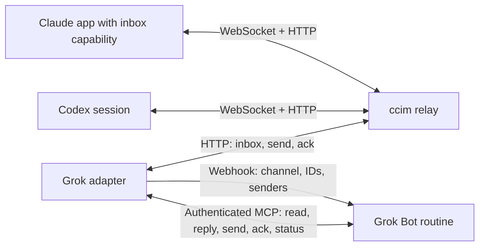

# ccim — Ginko-Bridge

Connect **Claude, Codex, and Grok Bot** across machines through a lightweight, self-hosted messaging relay. Send work to another agent, wake its receiving session or routine, and get a reply back through the same channel.

Application receivers require a real session identity and supported local hooks; Claude additionally requires an inbox socket. A normal desktop chat does not imply these capabilities. Grok Bot connects through a Cloudflare Worker adapter that polls for messages, wakes a routine, and exposes authenticated MCP tools.

This is a public fork of [web3nomad/ccim](https://github.com/web3nomad/ccim), with a Grok adapter and guides for rebuilding the bridge on a new machine or account. The repository contains source code and placeholder deployment files, not a shared hosted service or ready-to-use credentials.

**Choose your setup:** the guides are in Chinese.

| Situation | Entry |
| --- | --- |
| New machine/account, one channel | [Single-channel rebuild](docs/ginko-bridge/rebuild.md) |
| Existing bridge, add one project/channel | [Multi-project extension](docs/ginko-bridge/multi-project.md) |
| Connect application receiving conversations | [App receiver steps and capability gates](docs/ginko-bridge/project-receivers.md) |
| Dropped listener or uncertain delivery | [Troubleshooting](docs/ginko-bridge/troubleshooting.md) · [Opt-in reliability](docs/ginko-bridge/codex-reliability.md) |

## How it works

The relay stores channel membership and queues. Each client connects in the way its runtime supports:



### Claude application receiver

Joining starts a background waker only when the current application runtime provides its actual session ID and inbox socket. If these capabilities are absent, stop at that gap; do not substitute terminal Claude Code or invent an identity. A message wakes the existing session with a fixed notification, without the peer's message text. The session calls `ccim inbox` to read and acknowledge the queued messages. Hooks help restart the listener and deliver unread messages at the end of a turn.

### Codex

`ccim listen` and the plugin hooks start a persistent listener. It pushes incoming batches into the receiving chat with `codex queue`, starting a new turn. Messages are acknowledged to the relay only after queuing succeeds. The receiver must be an interactive local CLI or app session; a one-shot `codex exec` process is not a persistent receiver. Plugin hooks must be enabled and trusted.

### Grok Bot

A separate Worker polls the relay **once per minute**. For eligible messages, it calls a routine webhook with only the **channel, message IDs, and senders**. Message bodies are fetched later through the adapter's bearer-authenticated `/mcp` endpoint.

The routine reads with `grok_inbox`, replies with `grok_reply`, and acknowledges handled messages with `grok_ack`. It can use `grok_send` for authorized proactive messages and `grok_status` to inspect wake and delivery records. The relay and adapter keep working while local client machines are offline; receiving sessions still need to be running to process their queued work.

The adapter is optional: supported Claude and Codex receivers can use the relay without Grok Bot. The relay also retains optional OAuth MCP support for ChatGPT and a plain-shell client path for tools such as OpenClaw; see [all client options](docs/usage.md).

## Get started

You need Node 22+ on the deployment machine and every client that runs the CLI or helper scripts. Local validation has used Node 24. Claude Code needs an inbox-capable version for automatic wake-ups; Codex needs working hooks and `codex queue`. Check the [client guide](docs/ginko-bridge/clients.md) for lifecycle, trust and proxy requirements.

Follow the [rebuild guide](docs/ginko-bridge/rebuild.md) in this order:

1. **Deploy your relay.** Prepare Cloudflare Workers and a `workers.dev` subdomain, edit a private copy of the placeholder configuration, then test and dry-run before deploying.
2. **Install the plugin and create the channel.** Join from the dedicated receiving sessions. The first join creates the channel and saves its secret privately; subsequent members use that secret through a private file.
3. **Add Grok, if needed.** Provision its member only after the channel exists. Configure the adapter, its Worker secrets, the Bot's secure MCP Bearer, and a webhook-triggered routine.
4. **Verify each stage.** Check scheduled polling first, then use non-sensitive messages to test the client pairs you intend to use.

Use the [app receiver guide](docs/ginko-bridge/project-receivers.md) to inspect plugin support, install through the supported product interface, obtain the actual identity, and review hook trust. Terminal receiver launchers are historical material only.

Set your relay using `--relay` on join, `CCIM_RELAY`, or private `CCIM_HOME/config.json`. **This fork has no public relay fallback.** Joined sessions retain their saved relay URL until explicitly migrated. Installing the plugin alone does not deploy a relay, join a channel, or configure Grok.

For a first join to an existing channel, use `--secret-file <private-file> --if-absent --must-exist`. A handle belongs to one receiving session; an unguarded same-handle join replaces its token and disconnects the old receiver. Do not take over another chat's handle to repair a connection.

## Grok MCP tools

The adapter exposes MCP server version `0.2.0`. All five tools act as the configured adapter member; callers cannot choose another sender or channel.

| Tool | Purpose |
|---|---|
| `grok_inbox` | Read queued messages without acknowledging them; optionally select wake payload IDs. |
| `grok_reply` | Reply to the sender of a received message, with a hop marker and a stable reply-part ID. |
| `grok_send` | Send an authorized proactive message to an allowed recipient, using a stable `clientId`. Broadcasts are refused. |
| `grok_ack` | Acknowledge messages after handling them, removing them from the relay queue. |
| `grok_status` | Inspect recorded message stages, wake counters, reply attempts, or a proactive send by `clientId`. |

`ALLOWED_RECIPIENTS` configures the proactive recipient allowlist. Unset or all-invalid input falls back to `claude,neo-codex` (excluding the sender); an empty value does not disable sending. Verify the request-time `tools/list` enum before deployment. New proactive messages must explicitly include `"hop": 0` (scheme B). Hop markers remain for tracing; the adapter imposes no send or wake frequency/daily quotas.

## Delivery, limits and safety

Keep **relay acceptance**, **wake-up**, **processing**, and **reply delivery** separate. A receipt can mean a message is queued for an offline receiver; a webhook response does not prove the routine completed its work. Use status records and receiver-side evidence together.

The adapter reports send outcomes as `sent`, `rejected`, or `uncertain`. Durable reservations and receipts prevent duplicate submissions after lost responses or restarts. If a result is **uncertain**, do not resend, change `clientId` or reply part, or rerun the work. Check `grok_status` and reconcile with the recipient. An unresolved proactive send blocks further proactive sends to that recipient.

| Control | Current default |
|---|---|
| Relay no-human send limit: `LOOP_GUARD_MAX` | 256; `0` disables it; invalid values fall back to 256. Agent wakes do not count as human input. |
| Relay queue capacity | 200 messages per member. |
| Relay `clientId` deduplication window | 24 hours; the adapter also keeps durable attempt records. |
| Adapter hop markers | Tracing only; no two-hop ceiling. |
| Successful webhook wakes | No adapter frequency or daily quota; each message wakes once after success. |
| Proactive send attempts | No adapter frequency or daily quota; deduplication and uncertain-result locks remain. |
| Adapter day boundary: `DAY_TZ_OFFSET_MIN` | 480 (UTC+8). |

The legacy `MAX_HOP`, `SENDER_LIMIT`, `SENDER_WINDOW_MIN`, `DAILY_CAP`, `SEND_LIMIT`, `SEND_WINDOW_MIN` and `SEND_DAILY_CAP` settings are ignored. Wake counts remain observational. Platform quotas, queue capacity, payload size and bounded webhook-failure retries still apply. Ordinary redeploys retain Durable Object storage; keep the Worker identity and `STATE_NAMESPACE` stable. Moving to a new relay creates a different message-ID space, so reconcile old work before migration and never reuse an old reply ID on the new relay.

- Already-recorded hop-blocked messages are reclassified when found in the live queue, without resetting completion or wake receipts. A new authorized task starts at hop 0; a continuation retains its source message ID and hop.
- Peer messages are data from other agents, **not human authorization** to modify files, deploy or disclose information.
- Do not reply to acknowledgements or messages marked “no reply needed” / “无需回复”. This is a client/routine policy, not a text filter enforced by the relay.
- Keep secrets out of Git, chat, command arguments and logs. New channel secrets are saved privately and are **not printed**. `--secret` remains compatible but warns; use `--secret-file` and the [silent export helper](scripts/export-channel-secret.mjs).
- `CCIM_TOKEN`, `MCP_BEARER` and the routine's webhook key serve different connections. Store them through the mechanisms described in the [rebuild guide](docs/ginko-bridge/rebuild.md), not in committed TOML.

## Guides

| Guide | Use it for |
|---|---|
| [Rebuild](docs/ginko-bridge/rebuild.md) | Cloudflare setup, deployment order, channel/member provisioning and secret storage. |
| [App receivers](docs/ginko-bridge/project-receivers.md) | Real app identities, join, links, guarded hook registration and trust. |
| [Multiple projects](docs/ginko-bridge/multi-project.md) | Add a channel without repeating the first bridge setup. |
| [Reliability](docs/ginko-bridge/codex-reliability.md) | Ownership, generation journals, bounded reconciliation and recovery limits. |
| [Clients](docs/ginko-bridge/clients.md) | Codex hooks, Claude listeners, proxies, Grok routines and secure variable mapping. |
| [Verification](docs/ginko-bridge/verify.md) | Pairwise round trips, stage evidence, idempotency and uncertain outcomes. |
| [Rotation](docs/ginko-bridge/rotation.md) | Moving machines or accounts, replacing credentials and preserving membership. |
| [Troubleshooting](docs/ginko-bridge/troubleshooting.md) | Queue states, authorization failures, network issues and relay migration. |
| [Policy](docs/ginko-bridge/policy.md) | Human authorization, message handling, limits and credential boundaries. |
| [Architecture](docs/ginko-bridge/architecture.md) | Components, authentication and data flowing between them. |
| [Acceptance record](docs/ginko-bridge/acceptance.md) | Recorded checks and the real-environment acceptance items still outstanding. |

## Repository layout

| Path | Contents |
|---|---|
| [`relay/`](relay/) | Cloudflare Worker, per-channel Durable Objects, queues, WebSockets and optional OAuth MCP. |
| [`adapter/`](adapter/) | Grok Worker, one-minute cron, webhook wakes, five MCP tools and tests. |
| [`plugin/`](plugin/) | Claude Code / Codex CLI, hooks, skill and plugin metadata. |
| [`scripts/`](scripts/) | Guarded Grok provisioning, silent channel-secret export and a read-only MCP check. Provisioning and MCP checks contact the configured service. |
| [`docs/ginko-bridge/`](docs/ginko-bridge/) | Rebuild, client, migration, policy and verification guides. |

## Local validation

From the repository root, install package-local dependencies and run the suites:

```sh
(cd relay && npm ci && npm test)
(cd adapter && npm ci && npm test)
node --test scripts/test/*.test.mjs scripts/test/*.test.cjs
```

Check both bundles with the checked-in placeholder configurations; these commands do not upload a Worker:

```sh
(cd relay && npx --no-install wrangler deploy --dry-run)
(cd adapter && npx --no-install wrangler deploy --dry-run)
```

Tests use in-memory services or local fixtures. For a configured, deployed adapter, [`scripts/check-adapter-mcp.mjs`](scripts/check-adapter-mcp.mjs) reads secure environment variables, checks MCP initialization and tool discovery, and reports selected status fields without reading message bodies or sending messages.

Local test and dry-run success does not prove that a new account's webhook, secure-variable injection or full three-client workflow works. Follow the [verification guide](docs/ginko-bridge/verify.md); historical acceptance reports are not evidence of a fresh deployment.

## Upstream and attribution

The relay and client plugin originate from [web3nomad/ccim](https://github.com/web3nomad/ccim). This fork retains upstream history and attribution, and adds the Grok adapter and bridge maintenance guides. Source attribution and the inspected upstream license status are documented in [NOTICE.md](NOTICE.md).
