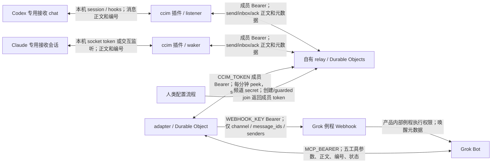

# 架构与信任边界

所有公网跳使用 HTTPS。本机 socket/CLI 不是公网 Bearer 接口；其权限来自本地用户和产品会话。
relay 接收完整正文；adapter 拉取并缓存 grok inbox，向 webhook 只发送元数据，Grok 再经 MCP 读取正文。
频道 secret 仅用于频道管理/加入等协议操作；成员操作使用各自 token。Grok 不持有 CCIM_TOKEN。
默认重建关闭 OAuth；可选 OAuth 属 relay `/mcp` 的另一路认证，不能把它与 adapter MCP_BEARER 混用。

adapter 状态由 STATE_NAMESPACE 按 relay/频道/成员隔离；普通部署保留相同存储和 namespace。
迁移中继须更换作用域并交接旧待办；消息编号不是跨中继全局 ID。
发送 reservation、clientId 记录和 uncertain 收件人锁用于避免“已收但响应失败”后的重复发送。
hop 和每日唤醒计数用于追溯，不设置 adapter 跳数、发送频率或每日硬额度；幂等、成功后不重复唤醒和不确定结果锁仍生效。保护规则见 [policy.md](policy.md)。
